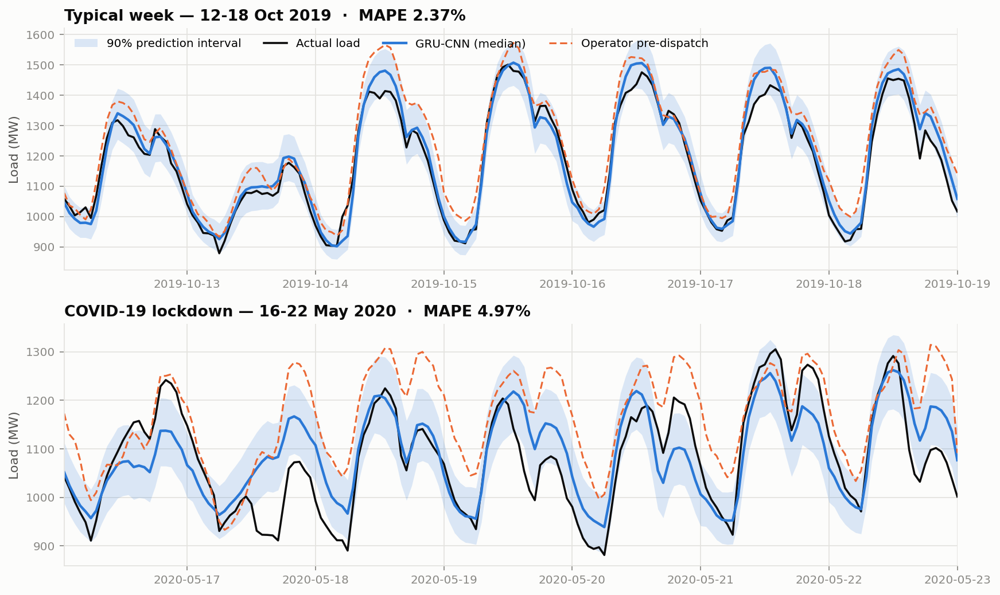
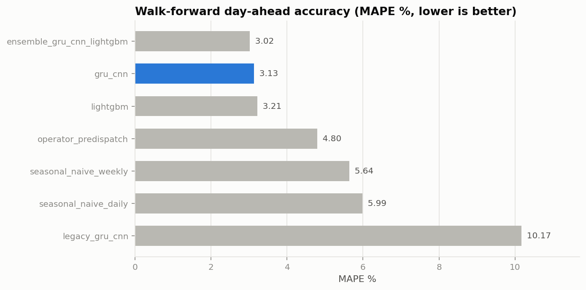
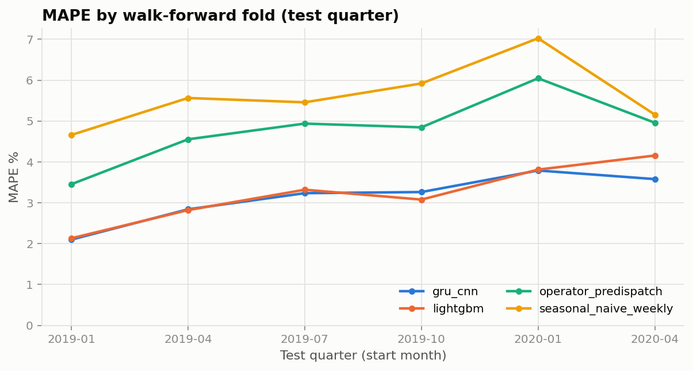
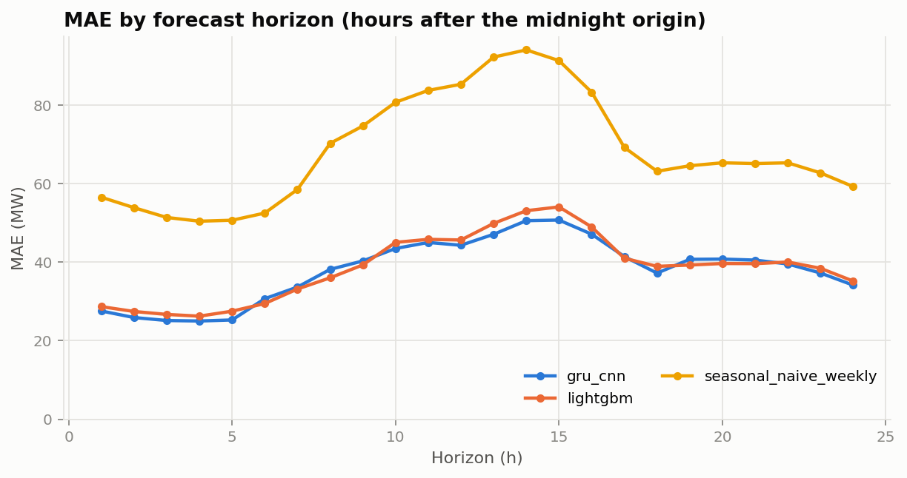
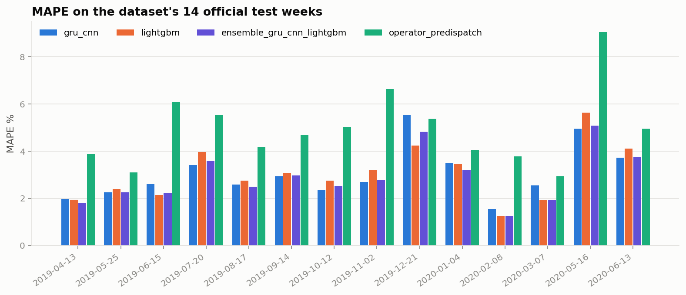
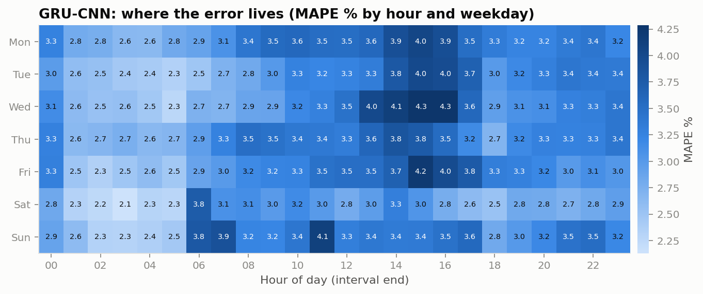
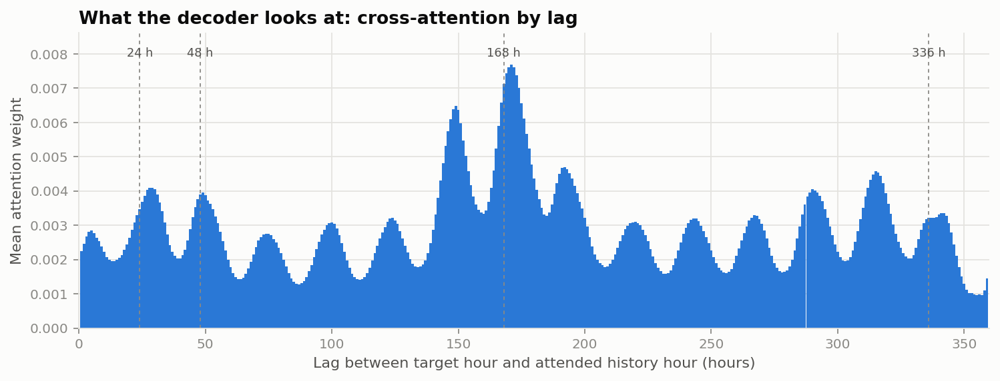
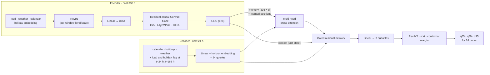

<div align="center">

# STLF · Hybrid GRU-CNN

**Day-ahead short-term load forecasting for the Panama national grid**<br>
CNN → GRU encoder · cross-attention decoder · calibrated quantile forecasts · walk-forward validated

[](https://github.com/Baraa-Melhem/stlf-gru-cnn/actions/workflows/ci.yml)


[](https://github.com/astral-sh/ruff)
[](LICENSE)
[](https://www.kaggle.com/code/baraamelhem/stlf-based-on-gru-cnn-hybrid-model)

</div>

<p align="center">
  
</p>

**Headline (Jan 2019 – Jun 2020, 13,000+ hourly forecasts, 6 walk-forward folds):** the hybrid
network reaches **3.13 % MAPE / 38 MW MAE**. That is **69 % lower error than the 2024 notebook's
model** (10.17 % when evaluated honestly) and **35 % lower than the grid operator's official
forecast** (4.80 %; see the caveat below). An equal-weight blend with a LightGBM baseline brings it
to **3.02 %**.

---

## Contents

1. [What changed since the 2024 notebook](#what-changed-since-the-2024-notebook)
2. [Results](#results)
3. [Method](#method)
4. [Quickstart](#quickstart)
5. [Repository layout](#repository-layout)
6. [Reproducing every number](#reproducing-every-number)
7. [Limitations](#limitations)
8. [Citation and data](#citation-and-data)

---

## What changed since the 2024 notebook

The [original Kaggle notebook](https://www.kaggle.com/code/baraamelhem/stlf-based-on-gru-cnn-hybrid-model)
(kept verbatim in [`legacy/`](legacy/original_kaggle_notebook.ipynb)) implemented the GRU-CNN idea of
Wu et al. (2020) in Keras and reported a test RMSE of ~143 MW. A line-by-line audit found that its
setup could not measure — or deliver — a real forecasting skill:

| # | Issue in the 2024 notebook | Consequence | Fix in this repository |
| --- | --- | --- | --- |
| 1 | Every sample is **one timestep** (`reshape(n, 1, features)`) | The GRU has no sequence to recur over; `Conv1D(kernel_size=1)` + `MaxPooling1D(pool_size=1)` are per-row dense layers. The "hybrid" is an MLP. | Two-week (336 h) encoder window; causal residual CNN feeding a GRU; cross-attention decoder |
| 2 | **No load history** among the inputs | The model must guess load from weather alone; the single most predictive signal (yesterday/last week) is unused | Past load is encoder channel 0, plus same-hour lags (t−24 h, t−168 h) in the decoder |
| 3 | `train_test_split(shuffle=True)` on a time series | Test hours are interpolated between neighbouring training hours (the Unix-timestamp feature makes this explicit) | 6 expanding-window walk-forward folds, retrained per fold |
| 4 | `StandardScaler` fitted on all 48k rows before splitting | Test-period statistics leak into training | Scaler fitted on each fold's training rows only |
| 5 | Test set passed as `validation_data` and the last of 200 epochs reported | Model selection on the test set; results vary 135-147 MW across reruns | Separate 8-week validation block for early stopping; seeds fixed; multi-seed reporting |
| 6 | Holiday/school flags and hour-of-day ignored, although the EDA showed their effect | Systematic errors on holidays, weekends and daily peaks | Cyclical calendar encodings, holiday/school flags, holiday-id embedding, lagged holiday flags |
| 7 | Raw MW targets with MSE and dropout 0.5 everywhere | Slow, unstable optimisation dominated by blackout outliers | Standardised targets, RevIN, pinball loss, AdamW + warm-up/cosine, gradient clipping, AMP |
| 8 | Point forecasts only, a single metric (RMSE) | No uncertainty, no context for the number | 90 % intervals with conformal calibration; MAE/RMSE/MAPE/sMAPE/R²/MASE, PICP/Winkler, per horizon/fold/hour |
| 9 | No baseline | Impossible to tell whether 143 MW is good | Seasonal naive, LightGBM, and the grid operator's own official forecast |
| 10 | 40-cell notebook with copy-pasted pipelines and global state | Not reusable or testable | Typed package, YAML configs, CLIs, 70 tests, CI |
| 11 | Hyper-parameters hand-picked | No evidence they suit the data | Optuna search scored on a pre-test inner backtest, confirmed on held-out 2018 quarters ([selection log](reports/model_selection.md)) |

---

## Results

All numbers come from [`reports/benchmark.md`](reports/benchmark.md), regenerated by
`python evaluate.py --benchmark`. Every model forecasts the next 24 hours at each midnight; every
fold is retrained from scratch on earlier data only; 5 blackout hours are excluded for all models.

| Model | MAPE % | MAE (MW) | RMSE (MW) | R² | MASE | 90 % PI coverage | Official weeks MAPE % |
| --- | ---: | ---: | ---: | ---: | ---: | ---: | ---: |
| **GRU-CNN + LightGBM** (equal-weight blend) | **3.02** | **36.4** | **50.9** | **0.93** | **0.65** | 88.0 % | **2.90** |
| **GRU-CNN** (this repo, 3-seed ensemble) | 3.13 | 38.0 | 52.3 | 0.92 | 0.68 | 84.4 % | 3.05 |
| LightGBM (3-seed ensemble, same features) | 3.21 | 38.7 | 54.0 | 0.92 | 0.69 | 85.7 % | 3.06 |
| Grid operator's weekly pre-dispatch forecast¹ | 4.80 | 57.6 | 76.0 | 0.84 | 1.03 | – | 4.95 |
| Seasonal naive — same hour last week | 5.64 | 68.5 | 97.2 | 0.73 | 1.23 | 83.6 % | 5.96 |
| Seasonal naive — same hour yesterday | 5.99 | 74.7 | 115.1 | 0.62 | 1.34 | 91.4 % | 6.71 |
| 2024 Kaggle GRU-CNN, re-run under this protocol | 10.17 | 119.7 | 151.0 | 0.35 | 2.14 | – | 9.85 |

¹ CND Panama's official forecast is **week-ahead** and was made with weather *forecasts*; the
models here are day-ahead and use observed weather (see [limitations](#limitations)). It is the
industry reference point, not a like-for-like competitor.

**How to read this honestly.**

* **Against the 2024 notebook:** the original architecture, re-run under a chronological split
  with train-only scaling, scores 10.17 % MAPE / 151 MW RMSE (its notebook reported ~143 MW RMSE on
  a shuffled split). It never sees past load, so it collapses to 20 % MAPE when the COVID-19
  lockdown moves load away from the weather-driven pattern.
* **Against LightGBM:** a *single* GRU-CNN (3.26 ± 0.03 % across seeds) is on par with a single
  LightGBM model (3.23 ± 0.01 %). The network pulls ahead as an ensemble (3.13 vs 3.21 %), because
  its seeds disagree more and so average out better, and under **distribution shift**: in the
  COVID-19 quarter it scores **3.58 % vs 4.16 %**, where RevIN's level-invariance pays off.
  Blending the two families beats both, since they make different mistakes.
* **Intervals:** coverage is 84-88 % for a nominal 90 %. Calibration is done on the 8 weeks before
  each fold, and 2019-2020 was more volatile than the 8-week windows that preceded each fold.

<p align="center">
  
  
</p>

### Ablations

Each row removes one component from the flagship (single seed, same six folds; the full model's
seed-0 score is 3.23 %, and the seed-to-seed standard deviation is 0.03).

| Variant | MAPE % | Δ vs full | Reading |
| --- | ---: | ---: | --- |
| Full model (seed 0) | 3.23 | – | |
| − RevIN | 3.68 | **+0.45** | The most important component: per-window normalisation absorbs trend and the COVID level shift. |
| − lag anchors (t−24 h, t−168 h + holiday flags) | 3.37 | **+0.15** | Explicit same-hour references help every horizon. |
| − future weather (weather observed only up to the origin) | 3.36 | +0.13 | What the perfect-weather-forecast assumption is worth. |
| − cross-attention decoder | 3.31 | +0.08 | Direct look-up of the relevant history beats a single context vector. |
| − GRU (CNN-only encoder) | 3.22 | −0.01 | Within noise. |
| − CNN (GRU-only encoder) | 3.17 | −0.06 | Within ~2σ of noise, slightly *better*. |

The last two rows deserve a plain statement: **after tuning, the gains come from RevIN, the lag
anchors and the attention decoder, not from stacking a CNN on the GRU.** Either encoder alone is
as good as both together, and the hyper-parameter search had already shrunk the convolutional
front-end to a single block. The hybrid encoder is kept as the reference architecture of this
project, and `configs/ablation_no_cnn.yaml` is a drop-in, slightly simpler alternative.

### Diagnostics

<p align="center">
  
  
</p>

* **By horizon:** error rises from ~25 MW for the first hours to ~50 MW for the hours ending
  13:00-15:00, where cooling load makes demand most weather-sensitive, then falls again in the
  evening. The GRU-CNN is ahead of LightGBM in the first 5 hours and around the afternoon peak.
* **The 14 official test weeks** proposed by the dataset authors: 3.05 % (GRU-CNN), 3.06 %
  (LightGBM), **2.90 %** (blend), 4.95 % (operator). The GRU-CNN's hardest week is Christmas 2019 (5.6 %).

<p align="center">
  
</p>

#### What the model attends to

<p align="center">
  
</p>

Averaged over the final model's validation forecasts, the decoder's attention peaks at the **same
hour one week earlier (168 h)**, with secondary peaks at every daily multiple: the model
rediscovered weekly and daily seasonality from data rather than being handed it.

Per-run metrics (by fold, horizon, seed and official week), resolved configs, training curves and
figures live in [`reports/runs/`](reports/runs); the model-selection trail is in
[`reports/model_selection.md`](reports/model_selection.md); a narrated walkthrough with live
outputs is in [`notebooks/stlf_gru_cnn.ipynb`](notebooks/stlf_gru_cnn.ipynb).

---

## Method

### Problem setting

Every day at **00:00** the model issues a forecast for the next **24 hourly loads**, using the
last 336 hours (two weeks) of load and weather, and calendar/holiday/school information for the forecast
day. Weather for the forecast day is taken from the reanalysis data, i.e. a **perfect weather
forecast**, a common STLF simplification (the dataset's own test frames also carry observed
temperature) but an optimistic one (see the [ablation](#ablations) and [limitations](#limitations)).

### Architecture



| Component | Why it is there |
| --- | --- |
| **Sequential CNN → GRU** | A residual block of two *causal* convolutions (9-hour receptive field) extracts local shapes — ramps, peaks — and denoises; the GRU integrates them over two weeks. This is the ordering the GRU-CNN literature intends; in the 2024 notebook both branches saw a single row. Causal (left-only) padding matters: symmetric padding convolved the hours just before the origin with zeros and cost 0.13 MAPE points in model selection. |
| **Cross-attention decoder** | Each target hour queries the whole history directly, so it can pick out the matching hour yesterday or last week instead of relying on one compressed hidden state ([attention figure](#what-the-model-attends-to)). |
| **Same-hour lag anchors** | `y(t−24)` and `y(t−168)` are already observed at the origin; feeding them to the decoder (RevIN-normalised like the history), together with flags saying whether those hours were holidays, gives every horizon an explicit and trustworthy seasonal reference. |
| **RevIN** (Kim et al., 2022) | Normalises each input window by its own mean and std and maps the forecast back. The model learns *shape*, so a +2 %/yr trend or the −15 % COVID-19 drop does not push inputs out of the training range. A unit test checks the resulting affine equivariance. |
| **Direct multi-horizon** | All 24 hours in one forward pass: no recursive error accumulation, one model for every lead time. |
| **Quantile (pinball) loss** | Median for the point forecast (robust to blackout spikes, unlike MSE) plus the 5 %/95 % quantiles. |
| **Conformal calibration** (Romano et al., 2019) | Quantile heads are over-confident; the interval is widened by the empirical quantile of the validation-block misses so it reaches its nominal 90 %. |
| **Gated residual network** (Lim et al., 2021) | A gate lets the decoder fall back to a near-linear map when extra capacity only over-fits. |

### Data pipeline and leakage controls

* **Schema and continuity checks** — the loader rejects missing columns, duplicated or missing
  hours, and NaN covariates.
* **Blackout handling** — 8 hours where load drops below 50 % of the *trailing* weekly median
  (no look-ahead) are interpolated for training and **excluded from scoring for every model**.
* **Known vs. observed covariates** — each feature is declared either known over the horizon
  (calendar, holidays, weather when `future_weather: true`) or observed only up to the origin;
  the windowing code enforces it and refuses lag features shorter than the horizon.
* **Per-fold scaling** — `StandardScaler.fit` sees only rows up to the fold's training cut-off.
* **Labels, not inputs, are bounded** — a test window may read the history before it, but no
  training or validation label lies in or after the test fold.

### Training

AdamW (lr 8.5e-4, weight decay 5e-6), one warm-up epoch then a short 12-epoch cosine decay,
dropout 0.4, batch 256, gradient clipping at 1.0, mixed precision (fp16), early stopping
(patience 4) on the validation block with best-epoch restore. Every hour of the training period
is a forecast origin (33-44k overlapping windows per fold), so one epoch already shows each label
hour 24 times — the reason the best epoch arrives early and the schedule is kept short.
Hyper-parameters were chosen by `tune.py` (see the [model selection log](reports/model_selection.md)).

### Evaluation protocol

* **Walk-forward:** test period Jan 2019 → Jun 2020 split into six quarters; for each, a new model
  is trained on all earlier data (expanding window, from Jan 2015), early-stopped on the 8 weeks
  before the quarter, and used to forecast every day of the quarter at midnight.
* **Model selection happened before 2019:** design choices and hyper-parameters were compared
  on an inner walk-forward over 2018 (four quarterly folds), never on the 2019-2020 test folds —
  every step is recorded in [`reports/model_selection.md`](reports/model_selection.md).
* **Seeds:** the flagship and LightGBM are trained with 3 seeds per fold; tables report the
  3-seed ensemble, and [`reports/benchmark.md`](reports/benchmark.md) adds the across-seed standard
  deviation of the single-seed score.
* **Metrics:** MAE, RMSE, MAPE, sMAPE, R², MASE (scaled by the in-sample MAE of the weekly naive
  forecast), pinball loss, interval coverage (PICP), mean width (MPIW) and Winkler score; broken
  down by fold, horizon, hour × weekday and by the 14 official test weeks of the dataset.

---

## Quickstart

```bash
git clone https://github.com/Baraa-Melhem/stlf-gru-cnn.git
cd stlf-gru-cnn
python -m venv .venv && source .venv/bin/activate   # Windows: .venv\Scripts\activate
# CUDA users: install torch for your CUDA version first (https://pytorch.org/get-started/locally/)
pip install -e ".[dev]"

python download_data.py                                      # ~11 MB, SHA-256 verified
python train.py --config configs/gru_cnn.yaml                # ~2-3 min on a laptop GPU
python predict.py --artifact artifacts/gru_cnn --origin "2020-06-26 00:00"
```

```text
        target_time  horizon   q0.05   q0.50   q0.95  actual
2020-06-26 01:00:00        1   982.7 1,059.0 1,129.8 1,068.3
2020-06-26 02:00:00        2   960.3 1,032.7 1,101.7 1,040.0
2020-06-26 03:00:00        3   943.7 1,014.0 1,081.8 1,016.4
...
```

That origin lies inside the final model's training data; use an origin after your own training
cut-off for a genuine out-of-sample forecast.

Any config value can be overridden from the command line:

```bash
python evaluate.py --config configs/gru_cnn.yaml --set train.max_epochs=20 window.lookback=168
```

---

## Repository layout

```text
stlf-gru-cnn/
├── configs/                  # one YAML per experiment, all inheriting base.yaml
│   ├── base.yaml             #   shared data/feature/window/training/backtest settings
│   ├── gru_cnn.yaml          #   flagship model (tuned)
│   ├── ablation_*.yaml       #   one component removed at a time
│   ├── legacy_gru_cnn.yaml   #   the 2024 model, faithfully re-implemented
│   └── lightgbm.yaml, seasonal_naive_*.yaml, operator.yaml
├── src/stlf/
│   ├── config.py             # frozen dataclasses, YAML inheritance, strict validation
│   ├── data/                 # download (checksummed), loader, walk-forward splits, windowing
│   ├── features/             # calendar/holiday/weather features, leak-free scaler
│   ├── models/               # HybridGRUCNN, RevIN/conv/GRN layers, LegacyGRUCNN
│   ├── forecasters/          # Forecaster interface: neural, LightGBM, naive, operator
│   ├── training/             # pinball loss, trainer (AMP, clipping, early stopping, EMA)
│   ├── evaluation/           # metrics, backtester, reports, publication figures
│   └── cli/                  # train / evaluate / predict / tune / download
├── train.py  evaluate.py  predict.py  tune.py  download_data.py   # thin entry points
├── notebooks/stlf_gru_cnn.ipynb   # narrative walkthrough, executed
├── reports/                  # benchmark.md, model_selection.md, figures/, tuning/, runs/
├── tests/                    # 70 tests: leakage, causality, windowing, models, metrics, CLIs
├── legacy/                   # the original 2024 Kaggle notebook, unchanged
└── .github/workflows/ci.yml  # ruff + pytest on Python 3.10 and 3.12
```

Design notes:

* **One abstraction, many models.** The backtester, reports and CLIs depend only on
  `Forecaster.fit(data, split)` / `predict(data, origins)`. Each forecaster owns its preprocessing,
  which is what makes per-fold, leak-free scaling automatic.
* **Configuration is data.** Frozen dataclasses mirror the YAML; unknown keys and inconsistent
  settings (e.g. a lag shorter than the horizon) fail at load time. Each run saves its fully
  resolved config next to its metrics.
* **Fast windowing.** Windows are gathered on the GPU from contiguous tensors with one
  fancy-indexing call per batch, so stride-1 training adds neither memory nor Python overhead.

---

## Reproducing every number

```bash
python download_data.py
python tune.py --config configs/gru_cnn.yaml --trials 40          # optional: search on pre-2019 data
python evaluate.py --config configs/gru_cnn.yaml configs/lightgbm.yaml configs/legacy_gru_cnn.yaml \
    configs/seasonal_naive_weekly.yaml configs/seasonal_naive_daily.yaml configs/operator.yaml \
    configs/ablation_*.yaml
python evaluate.py --combine gru_cnn lightgbm --name ensemble_gru_cnn_lightgbm
python evaluate.py --benchmark                                    # writes reports/benchmark.md + figures
python train.py --config configs/gru_cnn.yaml --attention-plot reports/figures/attention.png
pytest
```

On a laptop RTX 3050 (6 GB) one fold trains in ~1-1.5 minutes: the flagship backtest
(6 folds × 3 seeds) takes ~25 minutes, each single-seed ablation ~8 minutes, LightGBM ~4 minutes
per seed on 8 CPU cores, and the final `train.py` model ~2-3 minutes.

GPU kernels are seeded but not forced to be bit-exact (`train.deterministic: false`), because
deterministic cuDNN kernels made training ~10× slower on the reference GPU. Expect tiny
run-to-run differences; set `--set train.deterministic=true` for bit-exact CPU/GPU reruns.

---

## Limitations

* **Perfect weather forecasts.** Weather over the forecast day comes from reanalysis, i.e. what
  actually happened. A deployment would use numerical weather forecasts; the
  `ablation_no_future_weather` run (weather only up to the origin) bounds the cost at about
  +0.13 MAPE points. Forecast-weather errors would land somewhere between the two.
* **One system, one period.** One national grid, and an 18-month test window that includes the
  COVID-19 lockdown. Results on other grids and periods will differ.
* **Under-covering intervals.** The 90 % intervals cover 84-88 % of test hours (see Results). A
  rolling recalibration that updates the conformal margin as new days arrive is the next step.
* **Single deep model ≈ gradient boosting.** One GRU-CNN is as accurate as one LightGBM model;
  the deep model's edge shows in ensembles and under distribution shift.
* **Selection disclosure.** Before the 2018 inner-backtest protocol was in place, one 2019-Q1
  test score was looked at during development; details are in the
  [model selection log](reports/model_selection.md).
* **Compute and determinism.** GPU training is seeded but not bit-exact by default (see above).
  Wall-clock times in `reports/runs/*/metrics.json` were measured on a shared machine and are not
  comparable between models.

---

## Citation and data

Data: Aguilar Madrid, E. (2021). *Short-term electricity load forecasting (Panama case study)*.
Mendeley Data, V1. [doi:10.17632/byx7sztj59.1](https://doi.org/10.17632/byx7sztj59.1) (CC BY 4.0).
Companion paper: Aguilar Madrid, E. & Antonio, N. (2021). *Short-Term Electricity Load Forecasting
with Machine Learning*. Information, 12(2), 50.

References: Wu, L., Kong, C., Hao, X. & Chen, W. (2020). A short-term load forecasting method
based on GRU-CNN hybrid neural network model. *Mathematical Problems in Engineering*. ·
Kim, T. et al. (2022). Reversible instance normalization for accurate time-series forecasting
against distribution shift. *ICLR*. · Lim, B. et al. (2021). Temporal Fusion Transformers.
*International Journal of Forecasting*. · Romano, Y., Patterson, E. & Candès, E. (2019).
Conformalized quantile regression. *NeurIPS*.

```bibtex
@software{melhem_stlf_gru_cnn,
  author = {Melhem, Baraa},
  title  = {STLF Hybrid GRU-CNN: day-ahead load forecasting for the Panama grid},
  year   = {2026},
  url    = {https://github.com/Baraa-Melhem/stlf-gru-cnn}
}
```

Released under the [MIT License](LICENSE).
